  <a href="https://www.nyakaru.co.ke"><b>nyakaru.co.ke</b></a>
  &nbsp;&middot;&nbsp;
  <a href="mailto:Lewis.nyakaru@gmail.com">Lewis.nyakaru@gmail.com</a>
  &nbsp;&middot;&nbsp;
  Nairobi, Kenya

 

## About

I'm a backend engineer who builds the systems behind products people depend on: the data models, the APIs, and the integrations that hold them together. Most of my work sits in domains where mistakes are expensive, such as **finance, legal tech and public safety**, so I care about correctness, security and code that is easy to reason about.

Today I'm a **Junior Backend Developer at [Revolution-Analytics](https://revolution-analytics.co.ke)**, building and maintaining FastAPI services for production platforms, including financial-statement analytics and trademark management. Before that I worked with **[Dukatech](https://dukatech.co.ke)** across frontend and backend, which is why I design APIs around the people who consume them, not just the spec.

I'm increasingly focused on **AI-powered software**: wiring language models into real workflows where they produce something a user can act on.

<b>Education</b> &nbsp; BSc Mathematics and Computer Science, Kenyatta University (2021&ndash;2025)

 

## What I do

<table>
  <tr>
    <td width="50%" valign="top">
      <h4>Backend engineering</h4>
      Designing and building REST APIs, application logic, authentication and authorization, and the database layer underneath them.
    </td>
    <td width="50%" valign="top">
      <h4>Software development</h4>
      Shipping production applications end to end, connecting frontends to backends and keeping application workflows reliable.
    </td>
  </tr>
  <tr>
    <td width="50%" valign="top">
      <h4>AI and data</h4>
      Integrating AI models into products, analysing data to answer business questions, and exploring practical machine learning.
    </td>
    <td width="50%" valign="top">
      <h4>Cloud and infrastructure</h4>
      Deploying and running applications on cloud services, and managing the databases and infrastructure they rely on.
    </td>
  </tr>
</table>

 

## Stack

Tools I have worked with in production and personal projects.

<table>
  <tr>
    <td width="150"><b>Languages</b></td>
    <td>
       
      SQL
    </td>
  </tr>
  <tr>
    <td><b>Backend</b></td>
    <td>
       
      REST APIs &middot; SQLAlchemy &middot; Auth &middot; Third-party integrations
    </td>
  </tr>
  <tr>
    <td><b>Frontend</b></td>
    <td></td>
  </tr>
  <tr>
    <td><b>Databases</b></td>
    <td>
       
      Oracle
    </td>
  </tr>
  <tr>
    <td><b>Cloud &amp; DevOps</b></td>
    <td>
       
      Cloud Run &middot; Cloud SQL
    </td>
  </tr>
  <tr>
    <td><b>AI &amp; tools</b></td>
    <td>
      
      
       
      AI integrations &middot; Data analytics
    </td>
  </tr>
</table>

 

## Featured work

<table>
  <tr>
    <td width="50%" valign="top">
      <h3><a href="https://amua.co.ke">Amua</a></h3>
      FINANCIAL ANALYTICS
      
An AI-powered platform that processes M-Pesa and bank statements into business intelligence, predictive analytics, fraud detection, automated reports and customer risk profiles, helping organisations make faster, better-informed decisions.

      
<code>React</code> <code>FastAPI</code> <code>PostgreSQL</code>

      <a href="https://amua.co.ke">amua.co.ke</a> &nbsp;&middot;&nbsp; Built at Revolution-Analytics
    </td>
    <td width="50%" valign="top">
      <h3><a href="https://kira.co.ke">Kira</a></h3>
      LEGAL TECH &middot; IP MANAGEMENT
      
A legal-tech platform for protecting intellectual property, with TMMS, a trademark management system for legal teams: portfolio management, renewal-deadline alerts, secure case documents and a dashboard of global registrations.

      
<code>React</code> <code>FastAPI</code> <code>PostgreSQL</code>

      <a href="https://kira.co.ke">kira.co.ke</a> &nbsp;&middot;&nbsp; <a href="https://tmms.kira.co.ke">tmms.kira.co.ke</a> &nbsp;&middot;&nbsp; Built at Revolution-Analytics
    </td>
  </tr>
  <tr>
    <td width="50%" valign="top">
      <h3><a href="https://github.com/thegr8lewis/gbv">Safespace</a></h3>
      CIVIC SAFETY &middot; GBV SUPPORT
      
A platform giving survivors of gender-based violence safe, immediate support: emergency assistance, incident reporting, AI-assisted guidance, and directions to nearby hospitals and police stations. I built the backend.

      
<code>Django REST Framework</code> <code>React</code> <code>PostgreSQL</code> <code>Leaflet</code>

      <a href="https://github.com/thegr8lewis/gbv">Source</a>
      <!-- TODO: add the live link here once safespacekenya.co.ke is reachable again:
      &nbsp;&middot;&nbsp; <a href="https://safespacekenya.co.ke">safespacekenya.co.ke</a> -->
    </td>
    <td width="50%" valign="top">
      <h3><a href="https://github.com/thegr8lewis/soma">Soma</a></h3>
      E-LEARNING &middot; MOBILE + WEB
      
A gamified learning app for primary-school students, with quizzes, rewards, instant feedback and progress tracking, plus a teacher dashboard. Built mobile-first in Flutter with a React web companion.

      
<code>Flutter</code> <code>Dart</code> <code>React</code>

      <a href="https://github.com/thegr8lewis/soma">Source</a> &nbsp;&middot;&nbsp; Built at Dukatech
    </td>
  </tr>
</table>

  
<b>More on GitHub</b>

   

  - **[SafeAI backend](https://github.com/thegr8lewis/Backend-deepscan-ai-probe)** &mdash; Django REST API that serves a Gemini model over web chat, file uploads, a Telegram bot and API-key clients, with OpenAPI docs.
  - **[Health Information System](https://github.com/thegr8lewis/Health-information-system)** &mdash; Doctor-facing platform for health programs and patient records, with role-based access and a REST API.
  - **[AI Avatar](https://github.com/thegr8lewis/ai-avator)** &mdash; Browser-based 3D avatar with speech, lip sync and Gemini chat, built with Three.js.

 

## GitHub activity

  <picture>
    <source media="(prefers-color-scheme: dark)" srcset="./assets/generated/stats-dark.svg" />
    
  </picture>
  <picture>
    <source media="(prefers-color-scheme: dark)" srcset="./assets/generated/top-langs-dark.svg" />
    
  </picture>

  <picture>
    <source media="(prefers-color-scheme: dark)" srcset="https://streak-stats.demolab.com/?user=thegr8lewis&background=0D1117&border=30363D&stroke=30363D&ring=3DDC97&fire=3DDC97&currStreakNum=F0F3F6&sideNums=F0F3F6&currStreakLabel=3DDC97&sideLabels=C9D1D9&dates=8B949E&border_radius=12" />
    
  </picture>

  <picture>
    <source media="(prefers-color-scheme: dark)" srcset="./assets/generated/snake-dark.svg" />
    
  </picture>

 

## Currently focused on

- Production API development with **FastAPI** and **PostgreSQL**
- Building **AI-powered software** that holds up in real workflows
- Running services on **Google Cloud** (Cloud Run, Cloud SQL)
- Deepening my **system design** and software engineering fundamentals

 

## Connect

  
  
  
  

Open to conversations about backend engineering, fintech, legal tech and AI-powered products.
