<a href="https://www.nyakaru.co.ke">
  <picture>
    <source media="(prefers-color-scheme: dark)" srcset="./assets/banner-dark.svg" />
    
  </picture>
</a>

  <a href="https://www.nyakaru.co.ke"><b>nyakaru.co.ke</b></a>
  &nbsp;&middot;&nbsp;
  <a href="mailto:Lewis.nyakaru@gmail.com">Lewis.nyakaru@gmail.com</a>
  &nbsp;&middot;&nbsp;
  <a href="https://www.linkedin.com/in/lewis-nyakaru-8ba403239">LinkedIn</a>
  &nbsp;&middot;&nbsp;
  Nairobi, Kenya

 

## About

I'm a backend engineer who builds the systems behind products people depend on: the data models, the APIs, and the integrations that hold them together. Most of my work sits in domains where mistakes are expensive, such as **finance, legal tech and public safety**, so I care about correctness, security and code that is easy to reason about.

Today I'm a **Junior Backend Developer at [Revolution-Analytics](https://revolution-analytics.co.ke)**, building and maintaining FastAPI services for production platforms, including financial-statement analytics and trademark management. Before that I worked with **[Dukatech](https://dukatech.co.ke)** across frontend and backend, which is why I design APIs around the people who consume them, not just the spec.

I'm increasingly focused on **AI-powered software**: wiring language models into real workflows where they produce something a user can act on.

<b>Education</b> &nbsp; BSc Mathematics and Computer Science, Kenyatta University (2021&ndash;2025)

 

## What I do

<table>
  <tr>
    <td width="50%" valign="top">
      <h4>Backend engineering</h4>
      Designing and building REST APIs, application logic, authentication and authorization, and the database layer underneath them.
    </td>
    <td width="50%" valign="top">
      <h4>Software development</h4>
      Shipping production applications end to end, connecting frontends to backends and keeping application workflows reliable.
    </td>
  </tr>
  <tr>
    <td width="50%" valign="top">
      <h4>AI and data</h4>
      Integrating AI models into products, analysing data to answer business questions, and exploring practical machine learning.
    </td>
    <td width="50%" valign="top">
      <h4>Cloud and infrastructure</h4>
      Deploying and running applications on cloud services, and managing the databases and infrastructure they rely on.
    </td>
  </tr>
</table>

 

## Stack

Tools I have worked with in production and personal projects.

<table>
  <tr>
    <td width="150"><b>Languages</b></td>
    <td>
      <picture><source media="(prefers-color-scheme: dark)" srcset="https://skillicons.dev/icons?i=py%2Cjs%2Cjava&theme=dark" /></picture> 
      SQL
    </td>
  </tr>
  <tr>
    <td><b>Backend</b></td>
    <td>
      <picture><source media="(prefers-color-scheme: dark)" srcset="https://skillicons.dev/icons?i=fastapi%2Cdjango&theme=dark" /></picture> 
      REST APIs &middot; SQLAlchemy &middot; Auth &middot; Third-party integrations
    </td>
  </tr>
  <tr>
    <td><b>Frontend</b></td>
    <td><picture><source media="(prefers-color-scheme: dark)" srcset="https://skillicons.dev/icons?i=react%2Chtml%2Ccss&theme=dark" /></picture></td>
  </tr>
  <tr>
    <td><b>Databases</b></td>
    <td>
      <picture><source media="(prefers-color-scheme: dark)" srcset="https://skillicons.dev/icons?i=postgres%2Cmysql%2Cmongodb&theme=dark" /></picture> 
      Oracle
    </td>
  </tr>
  <tr>
    <td><b>Cloud &amp; DevOps</b></td>
    <td>
      <picture><source media="(prefers-color-scheme: dark)" srcset="https://skillicons.dev/icons?i=gcp%2Cdocker%2Credis%2Cgit%2Cgithub&theme=dark" /></picture> 
      Cloud Run &middot; Cloud SQL
    </td>
  </tr>
  <tr>
    <td><b>AI &amp; tools</b></td>
    <td>
      <picture><source media="(prefers-color-scheme: dark)" srcset="https://img.shields.io/badge/Claude_Code-1A1F24?style=for-the-badge&logo=claude&logoColor=D97757" /></picture>
      <picture><source media="(prefers-color-scheme: dark)" srcset="https://img.shields.io/badge/Claude_Design-1A1F24?style=for-the-badge&logo=claude&logoColor=D97757" /></picture>
      <picture><source media="(prefers-color-scheme: dark)" srcset="https://img.shields.io/badge/Gemini_API-1A1F24?style=for-the-badge&logo=googlegemini&logoColor=8E75B2" /></picture> 
      AI integrations &middot; Data analytics
    </td>
  </tr>
</table>

 

## GitHub activity

  <picture>
    <source media="(prefers-color-scheme: dark)" srcset="./assets/generated/stats-dark.svg" />
    
  </picture>
  <picture>
    <source media="(prefers-color-scheme: dark)" srcset="./assets/generated/top-langs-dark.svg" />
    
  </picture>

  <picture>
    <source media="(prefers-color-scheme: dark)" srcset="https://streak-stats.demolab.com/?user=thegr8lewis&background=0D1117&border=30363D&stroke=30363D&ring=3DDC97&fire=3DDC97&currStreakNum=F0F3F6&sideNums=F0F3F6&currStreakLabel=3DDC97&sideLabels=C9D1D9&dates=8B949E&border_radius=12" />
    
  </picture>

  <picture>
    <source media="(prefers-color-scheme: dark)" srcset="./assets/generated/snake-dark.svg" />
    
  </picture>

 

## Connect

  <a href="https://www.nyakaru.co.ke"><picture><source media="(prefers-color-scheme: dark)" srcset="https://img.shields.io/badge/Portfolio-nyakaru.co.ke-0D1117?style=for-the-badge&labelColor=0D1117&color=3DDC97" /></picture></a>
  <a href="mailto:Lewis.nyakaru@gmail.com"><picture><source media="(prefers-color-scheme: dark)" srcset="https://img.shields.io/badge/Email-0D1117?style=for-the-badge&logo=gmail&logoColor=3DDC97" /></picture></a>
  <a href="https://github.com/thegr8lewis"><picture><source media="(prefers-color-scheme: dark)" srcset="https://img.shields.io/badge/GitHub-0D1117?style=for-the-badge&logo=github&logoColor=3DDC97" /></picture></a>

Open to conversations about backend engineering, fintech, legal tech and AI-powered products.
